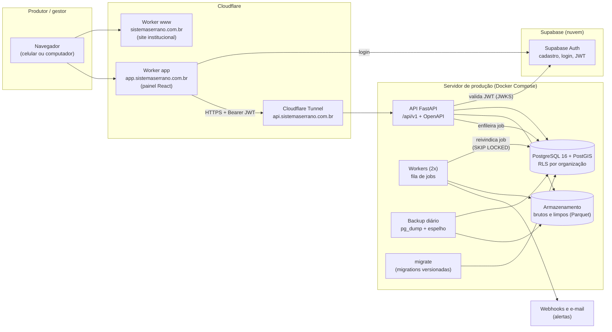
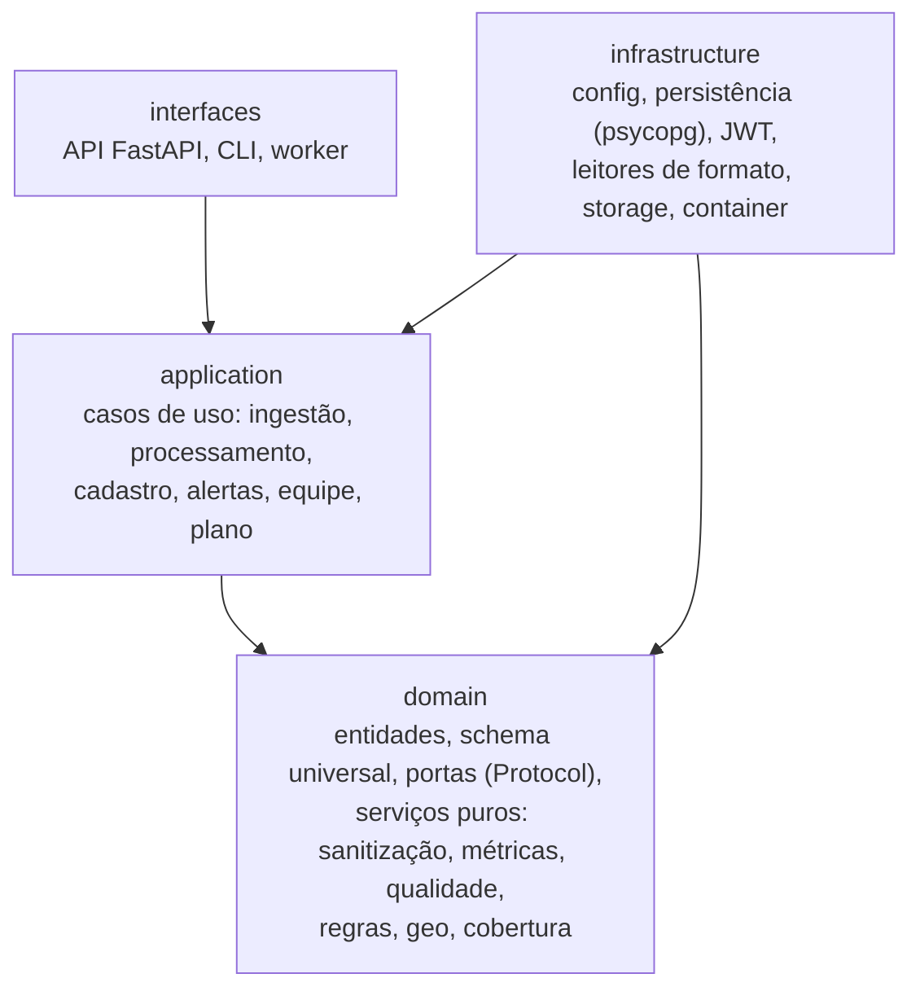
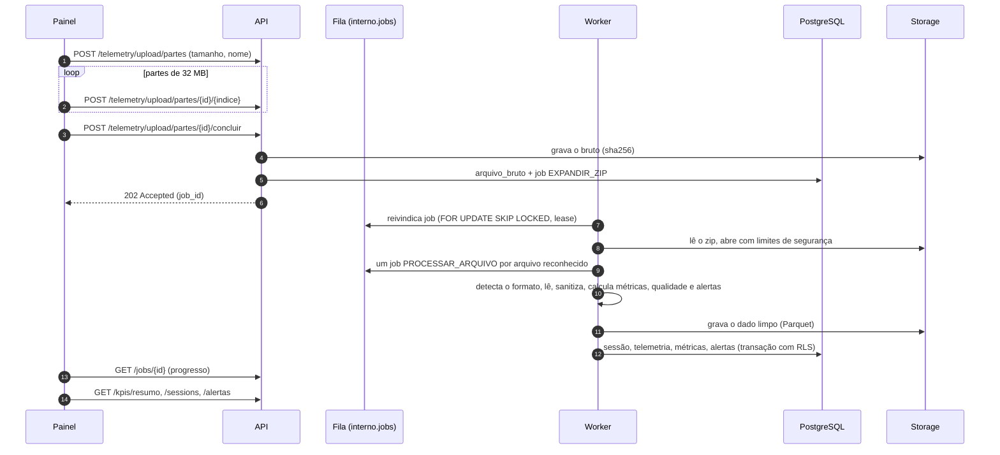

# Arquitetura da solução

A Serrano lê os arquivos que os monitores das máquinas agrícolas já gravam (de marcas e formatos
diferentes), limpa esses dados e transforma tudo em métricas por máquina, talhão e safra: horas de
motor, tempo parado, distância, área, diesel por hectare (L/ha), custo por hectare (R$/ha) e alertas.

## Visão geral

## Componentes

| Componente | Tecnologia | Papel |
|---|---|---|
| Site institucional | TypeScript + Vite, hospedado num Worker da Cloudflare | Apresenta a solução, planos, contato e documentos legais (LGPD). |
| Painel do cliente | React 18, Vite, TanStack Query, MapLibre GL, Recharts, Supabase JS | Envio de arquivos, mapa de calor, KPIs, máquinas, talhões, alertas, plano e equipe. |
| Autenticação | Supabase Auth | Cadastro, login e emissão de JWT. A API só valida o token (JWKS). |
| API | Python 3.11, FastAPI, Pydantic v2, psycopg 3 | 88 endpoints REST em `/api/v1`, documentação OpenAPI em `/docs`. |
| Worker | Mesmo código da API (`sistemacampero worker`) | Processa a fila: expande zip, lê cada arquivo, calcula métricas, grava resultados, envia notificações. |
| Leitores de formato (adapters) | Python, numpy, pandas | John Deere Gen4 (`.jdl`), John Deere GreenStar 3, ISOBUS (TASKDATA.XML), Trimble TMX-2050/PTx (Massey Ferguson), contornos de talhão (shapefile, KML, GeoJSON). |
| Banco de dados | PostgreSQL 16 + PostGIS | Dados multiempresa com Row Level Security; telemetria particionada por mês. |
| Armazenamento | Volume local (produção atual) ou Supabase Storage (nuvem) | Arquivo bruto original e o dado limpo em Parquet. |
| Exposição na internet | Cloudflare Tunnel | Publica a API sem abrir portas no servidor. |
| CI | GitHub Actions | Formatação, lint, tipos, testes com PostGIS real, auditoria de dependências e imagem Docker. |

## Camadas do backend (DDD)

O código segue camadas com dependência só para dentro:

- `domain/` não conhece FastAPI, banco nem variáveis de ambiente: é testável sem I/O.
- `infrastructure/parsers/` tem um adapter por marca/formato, todos convertendo para o mesmo
  **schema universal** (`ParsedSession`). Uma marca nova não muda o resto do sistema
  ([como adicionar uma marca](../como-adicionar-marca.md)).

Código: [`src/sistemacampero/`](../../src/sistemacampero).

## Fluxo de um envio de arquivo

O envio em partes existe porque a Cloudflare limita cada requisição a 100 MB, e pendrives reais
passam de 1 GB. A fila é durável: lease com renovação, reaper para worker que morreu, nova tentativa
com backoff e dead-letter ([ADR 0006](../adr/0006-ingestao-assincrona.md)).

## Decisões de arquitetura (ADRs)

- [ADR 0004: fundação do backend v1](../adr/0004-backend-v1-fundacao.md)
- [ADR 0005: formato `.jdl`, âncoras e GPS](../adr/0005-formato-jdl-ancoras-e-gps.md)
- [ADR 0006: ingestão assíncrona](../adr/0006-ingestao-assincrona.md)
- [ADR 0007: cadastro, localização por GPS e cobertura](../adr/0007-cadastro-geo-e-cobertura.md)

Formatos documentados: [GreenStar 3](../formatos/greenstar3-rcd.md), [ISOBUS / ISOXML](../formatos/isoxml.md).
