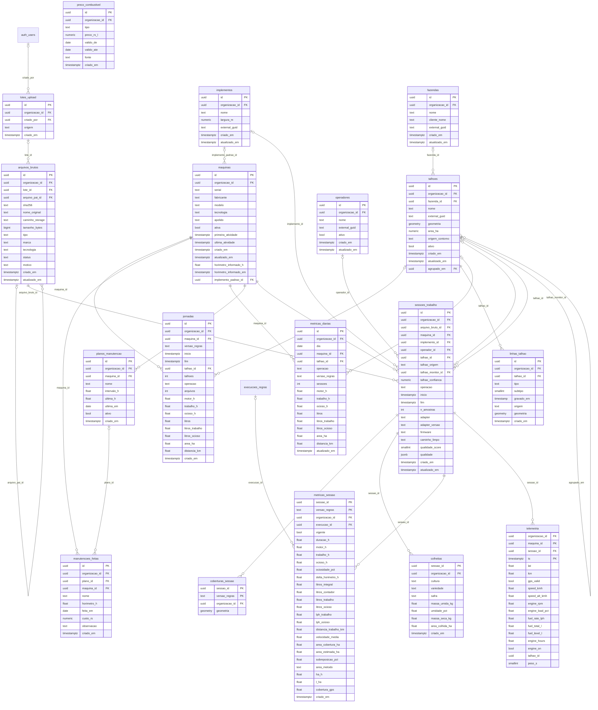
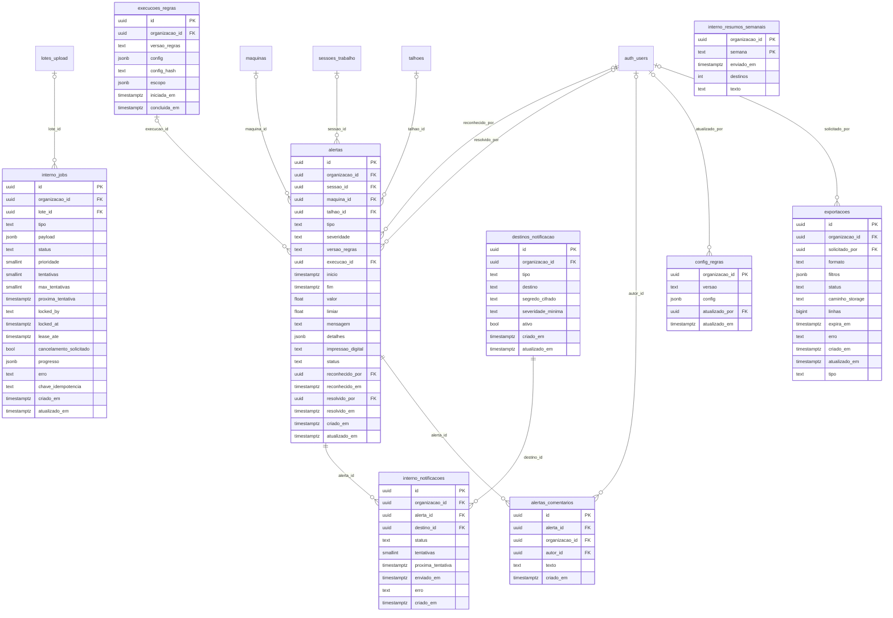

# Banco de dados (DER)

PostgreSQL 16 + PostGIS. O esquema é versionado em [`supabase/migrations`](../../supabase/migrations) e este documento é **gerado a partir dele** por [`scripts/gerar_der.py`](../../scripts/gerar_der.py).

- **39 tabelas** (`public`: dados do cliente; `interno`: fila, auditoria, chaves, LGPD), **76 chaves estrangeiras**.
- **Multiempresa:** toda tabela de cliente tem `organizacao_id` e política de Row Level Security. Para o diagrama ficar legível, a ligação de cada tabela com `organizacoes` só aparece no primeiro diagrama.
- **Telemetria particionada por mês** (`telemetria_yAAAAmMM`): consultas por período leem só as partições do intervalo.
- **Geometria:** contornos de talhão, linhas e coberturas em `geometry` (PostGIS, SRID 4326).
- `PK` = chave primária, `FK` = chave estrangeira.

## Organização, acesso, plano e LGPD

Quem usa o sistema, com que papel, em qual plano, e os registros exigidos por lei.

```mermaid
erDiagram
    organizacoes |o--o{ interno_auditoria : "organizacao_id"
    auth_users |o--o{ interno_chaves_api : "criado_por"
    organizacoes ||--o{ interno_chaves_api : "organizacao_id"
    organizacoes ||--o{ assinaturas : "organizacao_id"
    planos ||--o{ assinaturas : "plano_codigo"
    auth_users |o--o{ convites : "criado_por"
    organizacoes ||--o{ convites : "organizacao_id"
    organizacoes ||--o{ membros : "organizacao_id"
    auth_users ||--o{ membros : "usuario_id"
    organizacoes ||--o{ pedidos_assinatura : "organizacao_id"
    planos ||--o{ pedidos_assinatura : "plano_codigo"
    organizacoes {
        uuid id PK
        text nome
        text slug
        text fuso
        smallint inicio_safra_mes
        timestamptz criado_em
    }
    membros {
        uuid organizacao_id PK
        uuid usuario_id PK
        text papel
        timestamptz criado_em
    }
    convites {
        uuid id PK
        uuid organizacao_id FK
        text email
        text papel
        text token_hash
        timestamptz expira_em
        timestamptz aceito_em
        uuid criado_por FK
        timestamptz criado_em
    }
    assinaturas {
        uuid id PK
        uuid organizacao_id FK
        text plano_codigo FK
        text status
        timestamptz inicio
        timestamptz fim
        int max_maquinas_override
        timestamptz atualizado_em
    }
    planos {
        text codigo PK
        text nome
        int max_maquinas
        int preco_mensal_centavos
        text descricao
        smallint ordem
        bool destaque
        bool sob_consulta
        bool publico
        int preco_anual_centavos
        array recursos
    }
    pedidos_assinatura {
        uuid id PK
        uuid organizacao_id FK
        text plano_codigo FK
        text ciclo
        text mensagem
        text telefone
        uuid solicitado_por
        text status
        timestamptz criado_em
    }
    interno_chaves_api {
        uuid id PK
        uuid organizacao_id FK
        text nome
        text prefixo
        text hash
        array escopos
        uuid criado_por FK
        timestamptz criado_em
        timestamptz ultimo_uso_em
        timestamptz revogada_em
    }
    interno_auditoria {
        bigint id PK
        uuid organizacao_id FK
        uuid ator_id
        text ator_tipo
        text acao
        text recurso_tipo
        text recurso_id
        jsonb dados
        inet ip
        text request_id
        timestamptz criado_em
    }
    interno_registros_acesso {
        bigint id PK
        timestamptz ocorrido_em
        inet ip
        uuid usuario_id
        uuid organizacao_id
        text metodo
        text rota
        smallint status
        text request_id
    }
    interno_aceites {
        uuid id PK
        uuid usuario_id
        text documento
        text versao
        text ip_hash
        timestamptz aceito_em
    }
    interno_solicitacoes_exclusao {
        uuid id PK
        uuid usuario_id
        text email
        array organizacoes
        text status
        timestamptz agendada_para
        timestamptz criado_em
        timestamptz concluida_em
        text erro
    }
    interno_contatos {
        uuid id PK
        text nome
        text email
        text telefone
        text fazenda
        int hectares
        int maquinas
        text mensagem
        text origem
        text ip_hash
        text status
        timestamptz criado_em
        text politica_versao
        bool aceita_novidades
    }
```

## Frota, talhões e dados de operação

O que vem dos monitores: arquivos, sessões de trabalho, telemetria e métricas calculadas.

## Alertas, notificações e processamento

Regras, alertas e o que sai do sistema (e-mail, webhook, exportações), mais a fila de jobs.

