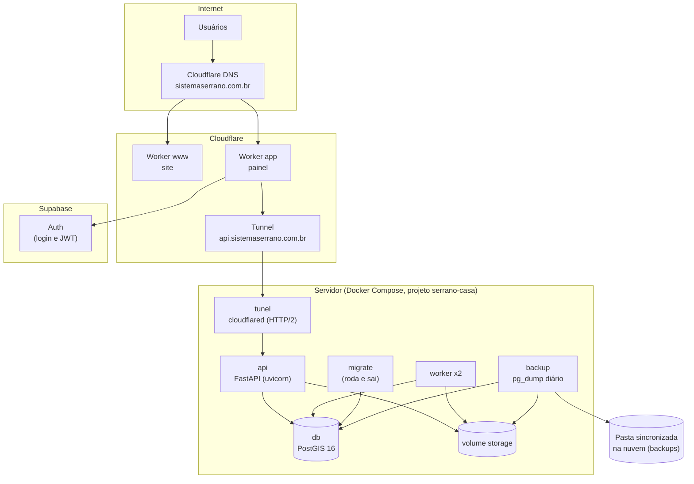

# Infraestrutura e implantação (deploy)

## Ambientes

| Ambiente | Onde | Para quê |
|---|---|---|
| Desenvolvimento | `docker compose up` na máquina do desenvolvedor ([`docker-compose.yml`](../../docker-compose.yml)) | PostGIS, migrations, API e worker locais; Swagger em `http://localhost:8000/docs`. |
| Teste (CI) | GitHub Actions com PostGIS em contêiner | Banco novo a cada execução, todas as migrations aplicadas. |
| Produção (piloto) | Servidor da equipe com Docker Compose ([`docker-compose.casa.yml`](../../docker-compose.casa.yml)) + Cloudflare + Supabase Auth | Clientes piloto e demonstração. |
| Produção (nuvem, planejada) | Supabase Pro (São Paulo) + API e worker em contêiner gerenciado (Fly.io/Railway) | Escala com clientes pagantes ([`docs/deploy.md`](../deploy.md)). |

## Produção atual

| Serviço | Imagem / tecnologia | Função |
|---|---|---|
| `db` | `postgis/postgis:16-3.4` | Banco com RLS; porta só em `127.0.0.1`. |
| `migrate` | Imagem da aplicação | Aplica as migrations versionadas e encerra; API e worker só sobem depois dele. |
| `api` | Imagem da aplicação (Python 3.11, uvicorn) | API REST; health check em `/health` e `/ready`. |
| `worker` (2 réplicas) | Imagem da aplicação | Processa a fila de jobs. |
| `tunel` | `cloudflare/cloudflared` | Publica a API em `api.sistemaserrano.com.br` sem abrir portas (protocolo HTTP/2). |
| `backup` | Script [`deploy/casa/backup.sh`](../../deploy/casa/backup.sh) | `pg_dump` diário + espelho dos arquivos; retenção de 7 dias; cópia numa pasta sincronizada na nuvem. |
| Site e painel | Cloudflare Workers (`www` e `app`) | Build automático a cada push na `main` (Workers Builds). |
| Autenticação | Supabase Auth (nuvem) | Cadastro, login e chaves JWKS. |

O passo a passo completo está em [`docs/producao-em-casa.md`](../producao-em-casa.md) e a operação
do dia a dia em [`docs/runbook.md`](../runbook.md).

## Configuração (variáveis de ambiente)

Validadas no boot com Pydantic (`infrastructure/config.py`); a aplicação não sobe com configuração
inválida. Modelo em [`.env.example`](../../.env.example). Segredos ficam fora do Git.

| Grupo | Variáveis |
|---|---|
| Ambiente | `AMBIENTE` (dev, test, staging, prod), `HOSPEDAGEM` (nuvem, casa) |
| Banco | `DATABASE_URL`, `CAMPERO_BACKEND_SENHA` |
| Autenticação | `SUPABASE_URL` (JWKS), `SUPABASE_SECRET_KEY` |
| Armazenamento | `STORAGE_BACKEND` (local, supabase), `STORAGE_DIR` |
| Limites | `MAX_UPLOAD_MB` (hoje 10 GB), limites de requisição por minuto |
| E-mail | `SMTP_HOST`, `SMTP_PORTA`, `SMTP_USUARIO`, `SMTP_SENHA`, `SMTP_REMETENTE` |
| Túnel e backup | `TUNNEL_TOKEN`, `BACKUP_DIR`, `BACKUP_DIAS` |
| CORS | origens permitidas do painel e do site |

## Integração e entrega contínuas (CI/CD)

| Workflow | Quando | O que faz |
|---|---|---|
| [`ci.yml`](../../.github/workflows/ci.yml) | Todo pull request e push na `main` | **qualidade** (ruff format, ruff check, mypy), **testes** (pytest com PostGIS real), **segurança** (auditoria de dependências), **imagem** (build do Docker). |
| [`migrations.yml`](../../.github/workflows/migrations.yml) | Push na `main` com migration nova, quando o banco é o Supabase | Aplica as migrations no banco de nuvem. |
| [`deploy.yml`](../../.github/workflows/deploy.yml) | Depois do CI verde na `main`, ou manual | Deploy da API e do worker no Fly.io (ambiente de nuvem). |
| Workers Builds (Cloudflare) | Push na `main` | Build e publicação do site (`www`) e do painel (`app`). |

Fluxo de uma mudança:

1. Branch e pull request; o CI precisa passar.
2. Merge na `main`: site e painel publicam sozinhos na Cloudflare.
3. Backend no servidor: `docker compose -p serrano-casa -f docker-compose.casa.yml --env-file .env.casa up -d --build`.
   O serviço `migrate` aplica migrations novas antes de API e worker subirem.
4. Conferência: `GET /health`, rota nova no `/openapi.json` e o painel publicado.

## Observabilidade e operação

- **Saúde:** `/health` (processo) e `/ready` (banco e storage).
- **Logs** estruturados em JSON com `request_id`, que também volta nas respostas de erro.
- **Métricas** Prometheus em `/metrics`.
- **Fila:** rotas de admin para ver jobs e reenfileirar mortos; reaper devolve jobs de worker que morreu.
- **Runbook** com procedimentos de incidente: [`docs/runbook.md`](../runbook.md).

## Limitações conhecidas e plano

| Limitação | Impacto | Plano |
|---|---|---|
| Servidor é um notebook da equipe | Se desligar ou entrar numa rede que bloqueia a porta 7844 do túnel, a API sai do ar | Máquina dedicada e, com clientes pagantes, nuvem (Supabase Pro + Fly.io/Railway em São Paulo). |
| Disco local | Pendrives de 1 GB ou mais ocupam espaço rápido | Política de retenção do arquivo bruto e storage em nuvem. |
| E-mail transacional | SMTP ainda não configurado em produção | Provedor transacional (ex.: Resend) para redefinição de senha e alertas. |

Custos estimados da nuvem em [`docs/deploy.md`](../deploy.md).
