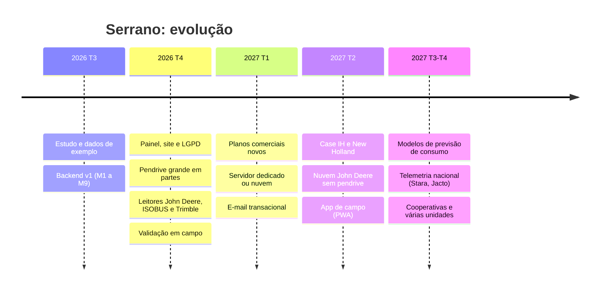

# Roadmap de evolução tecnológica

Onde a Serrano está e para onde vai. Datas são metas da equipe e podem mudar com os pilotos.

## Hoje (MVP em produção)

- Leitura de monitores John Deere (Gen4 e GreenStar 3), ISOBUS e Trimble (Massey Ferguson).
- Custo por hectare (L/ha e R$/ha) por máquina, talhão e safra; mapa de calor do consumo.
- Alertas de ociosidade e consumo com linha de base por máquina; notificação por e-mail e webhook.
- Equipe com papéis, chaves de API, auditoria, exportação CSV/XLSX, direitos LGPD.
- 314 testes automatizados, 91% de cobertura, CI completo.

## Curto prazo (1º trimestre de 2027)

| Entrega | Detalhe técnico |
|---|---|
| **Planos comerciais novos** | Tabela `planos` com os 4 planos, limite de usuários além do de máquinas, liberação de recursos por plano (mapa de calor, comparação de safras, manutenção, várias fazendas, webhook, API, XLSX). |
| Infraestrutura | Sair do notebook: máquina dedicada ou Supabase Pro + contêiner gerenciado em São Paulo; storage em nuvem com política de retenção. |
| E-mail transacional | Provedor dedicado para redefinição de senha, alertas e resumo semanal. |
| Onboarding | Conta de demonstração, guia de envio do pendrive, faixa realista de tempo de processamento. |
| Segurança | MFA para donos, criptografia de disco nos computadores da equipe, teste de intrusão. |

## Médio prazo (2º trimestre de 2027)

| Entrega | Detalhe técnico |
|---|---|
| Mais marcas | Leitores Case IH / New Holland (AFS, Intelliview) e Climate FieldView, seguindo o contrato de adapters. |
| Dado sem pendrive | Integração com a nuvem John Deere Operations Center (OAuth do produtor, sincronização agendada). |
| App de campo | Painel como PWA instalável, com alertas push e uso com internet fraca. |
| Upload retomável | Retomar envio interrompido em conexões rurais. |

## Longo prazo (2º semestre de 2027 em diante)

| Entrega | Detalhe técnico |
|---|---|
| **Inteligência preditiva** | Modelos de aprendizado de máquina treinados com a base agregada: previsão de consumo por operação e talhão, detecção de anomalias multivariada, recomendação de manutenção pelo padrão de uso. |
| Assistente | Perguntas em linguagem natural sobre a frota ("qual talhão teve o maior custo nesta safra?"). |
| Telemetria nacional | Integração com Stara e Jacto. |
| Cooperativas | Várias unidades, consolidação por grupo, integração com ERP sob medida. |

## Planos comerciais

Política nova definida pela equipe (todos com **30 dias grátis, sem cartão, sem taxa de instalação
e sem fidelidade**):

| Plano | Preço | Para quem | Inclui |
|---|---|---|---|
| **Essencial** | R$ 250/mês (R$ 2.500/ano) | Quem quer começar a enxergar o diesel | Até 3 máquinas e 2 usuários; todas as marcas e formatos; custo por hectare (L/ha e R$/ha) por máquina e talhão; alertas de ociosidade e consumo no painel |
| **Profissional** | R$ 400/mês (R$ 4.000/ano) | Quem quer controlar o custo da operação | Até 5 máquinas e 4 usuários; tudo do Essencial; mapa de calor do consumo; comparação de safras; manutenção pelo horímetro |
| **Completo** (recomendado) | R$ 690/mês (R$ 6.900/ano) | Tudo incluído para integrar e escalar | Até 10 máquinas e 8 usuários; tudo do Profissional; várias fazendas na mesma conta; alertas por e-mail e webhook, resumo semanal e API; exportação XLSX e integração com ERP; auditoria e papéis de usuário; implantação acompanhada e suporte prioritário |
| **Grupo e Cooperativa** | Sob consulta | Frotas grandes e várias unidades | Mais de 10 máquinas; várias fazendas e unidades; integração com ERP; implantação e suporte dedicados |

**Situação técnica:** os recursos de todos os planos já existem no sistema. Falta a parte comercial
no código: cadastrar os 4 planos (hoje há um plano único de lançamento), aplicar o limite de
**usuários** (o de máquinas já existe) e liberar cada recurso conforme o plano.
