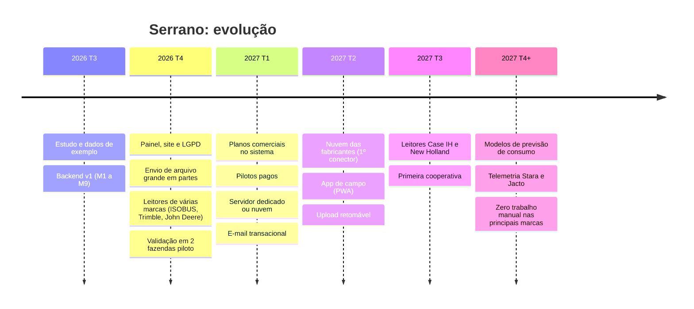

# Roadmap de evolução tecnológica

Onde a Serrano está e para onde vai. Datas são metas da equipe, alinhadas com o plano de negócio,
e podem mudar com os pilotos.

**Norte do produto:** todas as máquinas, de todas as marcas, num painel só, com **zero trabalho
manual**. Hoje, no MVP, o produtor envia pelo painel o arquivo que o monitor já grava; a evolução
principal é fazer o dado chegar sozinho, direto das plataformas online das fabricantes.

## Hoje (MVP em produção)

- **Coleta:** o produtor envia pelo painel o arquivo do monitor (zip do pendrive, até 10 GB, em
  partes com novas tentativas automáticas); o sistema reconhece o formato sozinho.
- Leitura de monitores de várias marcas: ISOBUS (padrão de diversas fabricantes), Trimble
  (Massey Ferguson), John Deere (Gen4 e GreenStar 3), com o mesmo schema universal.
- Custo por hectare (L/ha e R$/ha) por máquina, talhão e safra; mapa de calor do consumo.
- Alertas de ociosidade e consumo com linha de base por máquina; notificação por e-mail e webhook.
- Equipe com papéis, chaves de API, auditoria, exportação CSV/XLSX, direitos LGPD.
- 314 testes automatizados, 91% de cobertura, CI completo.
- Validado com dados reais de 2 fazendas piloto da região de Passo Fundo, com máquinas de marcas
  diferentes no mesmo painel.

## Caminho para o zero trabalho manual

| Etapa | Quando | Entrega técnica | Trabalho do produtor |
|---|---|---|---|
| Hoje · MVP | Em produção | Envio do arquivo pelo painel ou pela API, processamento automático | Envia o arquivo em poucos cliques |
| Próximo passo | 2º trimestre de 2027 | Primeiro conector com a plataforma online de uma fabricante: OAuth do produtor, sincronização agendada, entrada na mesma fila de jobs | Autoriza a conexão uma vez |
| Expansão | 2º semestre de 2027 | Conectores para as demais marcas da frota dos clientes, priorizados pela base instalada na região | Nenhum, nas marcas conectadas |
| Meta | Contínuo | Frota inteira chegando sozinha; envio de arquivo continua para máquinas sem conectividade | Só abre o painel e decide |

Cada conector é uma nova **porta de entrada**: leitores, métricas, alertas e painel não mudam
(ver [arquitetura](arquitetura.md)).

## Curto prazo (1º trimestre de 2027)

| Entrega | Detalhe técnico |
|---|---|
| **Planos comerciais no sistema** | Tabela `planos` com os 4 planos, limite de usuários além do de máquinas, liberação de recursos por plano (mapa de calor, comparação de safras, manutenção, várias fazendas, webhook, API, XLSX). |
| Infraestrutura | Sair do notebook: máquina dedicada ou Supabase Pro + contêiner gerenciado em São Paulo; storage em nuvem com política de retenção. |
| E-mail transacional | Provedor dedicado para redefinição de senha, alertas e resumo semanal. |
| Pilotos pagos | Conversão das fazendas piloto após os 30 dias grátis; acompanhamento dos envios e do uso. |
| Onboarding | Conta de demonstração, guia de envio do arquivo do monitor, faixa realista de tempo de processamento. |
| Segurança | MFA para donos, criptografia de disco nos computadores da equipe, teste de intrusão. |

## Médio prazo (2º e 3º trimestres de 2027)

| Entrega | Detalhe técnico |
|---|---|
| **Nuvem das fabricantes** (2º tri) | Primeiro conector com a plataforma online de uma fabricante: autorização do produtor por OAuth, tokens guardados cifrados, sincronização agendada e idempotente (sha256), entrada na mesma fila de jobs. Começa pela marca com API aberta e maior presença nas fazendas clientes. |
| App de campo (2º tri) | Painel como PWA instalável, com alertas push e uso com internet fraca. |
| Upload retomável (2º tri) | Retomar envio interrompido em conexões rurais. |
| Mais marcas (3º tri) | Leitores Case IH / New Holland (AFS, Intelliview) e Climate FieldView, seguindo o contrato de adapters. |
| Cooperativas (3º tri) | Primeira cooperativa: várias unidades e consolidação por grupo. |

## Longo prazo (4º trimestre de 2027 em diante)

| Entrega | Detalhe técnico |
|---|---|
| **Inteligência preditiva** | Modelos de aprendizado de máquina treinados com a base agregada: previsão de consumo por operação e talhão, detecção de anomalias multivariada, recomendação de manutenção pelo padrão de uso. |
| Assistente | Perguntas em linguagem natural sobre a frota ("qual talhão teve o maior custo nesta safra?"). |
| Telemetria nacional | Integração com Stara e Jacto. |
| Zero trabalho manual | Conectores para as principais marcas da frota dos clientes; envio de arquivo mantido para máquinas sem conectividade. |
| Cooperativas e grupos | Várias unidades em escala, integração com ERP sob medida. |

## Planos comerciais

Política nova definida pela equipe (todos com **30 dias grátis, sem cartão, sem taxa de instalação
e sem fidelidade**):

| Plano | Preço | Para quem | Inclui |
|---|---|---|---|
| **Essencial** | R$ 250/mês (R$ 2.500/ano) | Quem quer começar a enxergar o diesel | Até 3 máquinas e 2 usuários; todas as marcas e formatos; custo por hectare (L/ha e R$/ha) por máquina e talhão; alertas de ociosidade e consumo no painel |
| **Profissional** | R$ 400/mês (R$ 4.000/ano) | Quem quer controlar o custo da operação | Até 5 máquinas e 4 usuários; tudo do Essencial; mapa de calor do consumo; comparação de safras; manutenção pelo horímetro |
| **Completo** (recomendado) | R$ 690/mês (R$ 6.900/ano) | Tudo incluído para integrar e escalar | Até 10 máquinas e 8 usuários; tudo do Profissional; várias fazendas na mesma conta; alertas por e-mail e webhook, resumo semanal e API; exportação XLSX e integração com ERP; auditoria e papéis de usuário; implantação acompanhada e suporte prioritário |
| **Grupo e Cooperativa** | Sob consulta | Frotas grandes e várias unidades | Mais de 10 máquinas; várias fazendas e unidades; integração com ERP; implantação e suporte dedicados |

**Situação técnica:** os recursos de todos os planos já existem no sistema. Falta a parte comercial
no código: cadastrar os 4 planos (hoje há um plano único de lançamento), aplicar o limite de
**usuários** (o de máquinas já existe) e liberar cada recurso conforme o plano.
